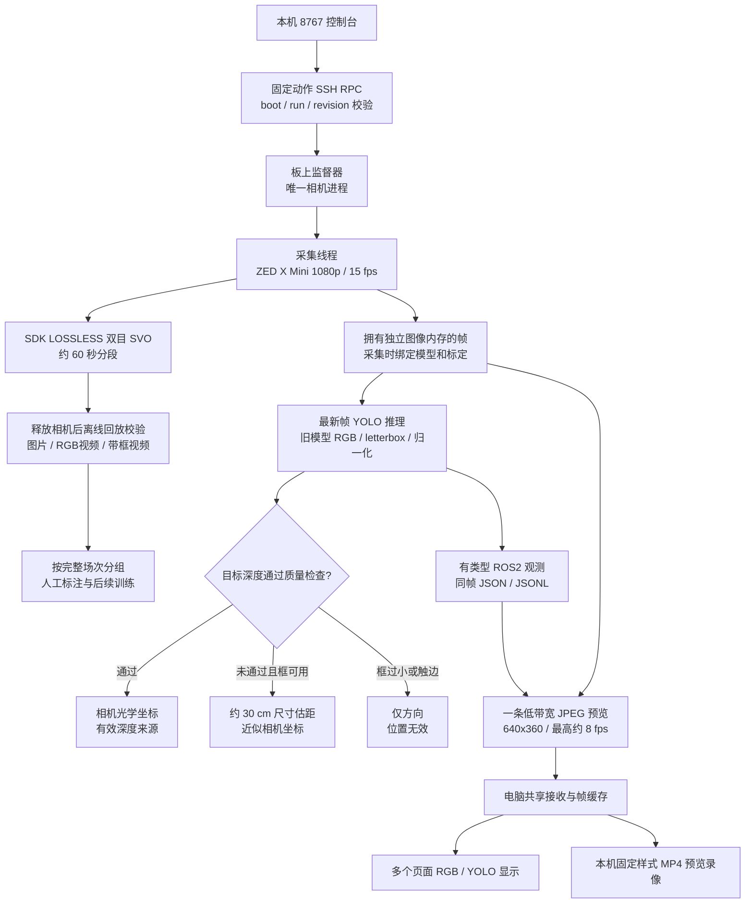

# ZED 感知与采集平台：代码流程、修改与验收

日期：2026-10-11。采集阶段继续使用现有 Jetson Orin Nano 8GB、DAMIAO ORIN NX V2 系列载板、ZED Link Mono 与 ZED X Mini 4mm。Ubuntu 22.04、L4T 36.4.3、ZED SDK 5.5、TensorRT 10.3 为本次实际环境。NX 16GB 尚未接入，也没有调整载板驱动、设备树或功耗模式。

本文件记录实际实现，优先于早先计划中的候选参数。软件已经部署；真实四旋翼识别/定位精度及正式长期压力验收仍需后续测试。

## 现在的代码流程



纯采集模式不加载模型，不计算深度。感知模式使用 NEURAL_LIGHT，并加载既有横版 YOLO 引擎。RGB 模式可在录像前启用 YOLO 做尺寸估距；需要实测深度时须停止相机、切到感知模式。

## 具体代码修改

板上源码位于 `/home/uavlab/Jetson_ROS2_V0/ros2_ws/src`。电脑面板部署位于 `C:/Users/yfx33/Documents/Codex/2026-10-06/ssh-172-20-10-3-uavlab/work/jetson_dashboard`。

| 文件 / 模块 | 实际职责 |
|---|---|
| `zed_perception_interfaces/msg/PerceptionFrame.msg` | 帧时间、相机坐标系、运行与模型身份、多目标列表 |
| `TargetObservation.msg` | 框、分数、方向、定位来源、有效位、Z、XYZ、深度支持与降级原因 |
| `PerceptionCommand.srv` | 有版本约束的异步感知命令，另有结果话题 |
| `zed_tracking/src/zed_perception_standalone.cpp` | 独立感知入口；相机、推理、预览和元数据线程；录像收尾与资源保护 |
| `include/zed_tracking/perception_quality.hpp` | 深度支持、背景分离、近似投影、目标关联、保持递增的轨迹 ID、场次工作收尾计数 |
| `src/trt_runner.hpp` | 静态 float32 输入检查；修复 TensorRT 有效维度枚举 |
| `src/zed_source.hpp` | 获取真实标定、相机序号和 SDK 录制统计，支持独立采集入口复用 |
| `tools/perception_supervisor.py` | 固定动作、进程身份、状态版本、串行控制、模型内容 SHA256 与固定副本 |
| `tools/build_model_manifest.py` | 当前引擎推理合同、PT/ONNX/engine 内容哈希与预处理记录 |
| `tools/export_svo_rgb.cpp` | 完整双目回放、逐帧时间戳 SHA256、原始左目抽帧；verify 不写映射 |
| `tools/export_session.py` | 分段及日志一致性校验、RGB/同帧框视频、按场次分组；大场次观测用磁盘 SQLite 查询 |
| `panel/dashboard.py`、`job_manager.py` | 本机回环 HTTP、安全来源校验、异步任务、状态缓存 |
| `frame_receiver.py` | 一条板端 JPEG 接收、按帧键取图、旧图过期处理、所有页面共用 |
| `preview_recorder.py` | 电脑固定 RGB/YOLO 样式录像；断链分段；有界队列与电脑磁盘保护 |
| `session_manager.py` | 限速 SFTP、取消/续传、源文件 SHA256 校验 |
| `index.html` | 连接、相机、两类录像、识别/方向/XYZ、模型、标定、素材与诊断界面 |

原有飞控、裁判和旧感知入口没有被新面板调用。原仓库已有的裁判文件修改与用户未跟踪文件保留。

编译产物放在独立的 `build_perception` / `install_perception`，新入口是：

```text
/home/uavlab/Jetson_ROS2_V0/ros2_ws/install_perception/zed_tracking/lib/zed_tracking/zed_perception_standalone
```

原始素材目录是 `/home/uavlab/Jetson_ROS2_V0/perception_records`。每场包含 manifest、完整标定副本、SVO 分段、采集/识别/资源/事件日志和收尾摘要。

## 坐标与降级规则

采用左相机光学坐标：X 右、Y 下、Z 前，单位米。将检测框中心像素 `(u,v)` 投影：

```text
X = (u-cx) × Z / fx
Y = (v-cy) × Z / fy
空间距离 = sqrt(X² + Y² + Z²)
```

没有可靠深度时，采用 `Z≈有效外廓尺寸 / max(框宽/fx, 框高/fy)`。有效外廓目前为 0.30 m 先验，姿态、桨叶、框松紧、截断和尺寸定义都会影响结果。目标框小于约 8 px 或触边时只给方向，不给有效坐标。

有效深度的候选区域须有足够中心像素、有效比例和单一深度簇；再检查背景分离、与尺寸先验的粗一致性及连续三次关联观测。此策略会保守降级，尤其在目标与背景距离接近、目标很薄或尺寸投影变化较大时。它是初始工程规则，不能代替真实四旋翼的定位精度验收。

深度位置定义为受支持表面沿框中心方向的位置，尚未标定到四旋翼几何中心。当前不输出未经标定的统计协方差：`covariance_valid=false`。估计距离和测得深度分字段，JSON 无效位置使用 null，有类型消息依靠有效位判读。

## 模型确实使用哪一份

默认 `exp_opt3.engine` 已实际加载并执行推理，输入 `[1,3,736,1280]`，输出 `[1,300,6]`，float32；RGB、0–1 归一化、letterbox 填充值 114。当前输出仅接收 class 0，类别记录为 drone。

```text
engine SHA256: f5ca6203076e96531ac9eae0f04f1da16fc31cfa51cdc04532bf1ac815ea66a2
PT SHA256:     c2ef85edb9c9cc0b31d0db4e690e324d5809115428344ee20a43c572b91a9437
ONNX SHA256:   200a04975f82fb648bd4e83f76efdf4034bad187525b263fce4d6a2cb464e55e
```

哈希说明本次使用的文件身份，不证明模型在真实四旋翼上准确。实际室内画面中出现背景误检，`recognition_validated=false`。新训练模型应在导出后核查颜色、输入方向、尺寸、类别顺序、输出合同与 PyTorch/ONNX 对照，再在板上通过引擎检查和实物验收后选用。

## 功能会不会冲突

| 同时操作 | 处理方式 |
|---|---|
| 原始录像 + RGB/YOLO预览 + 电脑录像 | 同一个采集者共享帧，支持同时运行；仍会竞争 CPU/GPU、NVMe 和图传带宽 |
| 多个浏览器页面 | 共用电脑的一条板端接收流；页面不另开相机 |
| YOLO暂停/同模型恢复 + 原始录像 | 允许；清空关联状态，轨迹编号不回到 1 |
| RGB录像中首次启用模型、切换模型、修改标定 | 拒绝，先停止录像 |
| 原始录像 + 图传/SSH/浏览器断开 | 板端原始录像继续；电脑预览中断，恢复后分段 |
| 离线导出或引擎检查 + 活动相机 | 拒绝，先释放相机 |
| 其他旧相机预览程序 + 新采集者 | 不应同时启动；先释放相机再换入口 |
| 下载 + 预览 | 下载限速 256 KiB/s；长大文件建议采集结束后下载 |

SDK LOSSLESS 保留双目图像，容量成本明显高于硬件压缩；官方录制文档说明编码方式及硬件编码的负载差别：[Stereolabs 视频录制](https://docs.stereolabs.com/docs/development/zed-sdk/modules/camera/recording)。Orin Nano 使用软件视频编码的背景见 [NVIDIA 软件编码文档](https://docs.nvidia.com/jetson/archives/r35.6.1/DeveloperGuide/SD/Multimedia/SoftwareEncodeInOrinNano.html)。本次根据实际回放成功结果采用 LOSSLESS，没有把未验证的 H264/H265 作为原始采集默认。

每约 60 秒关闭并开始新 SVO，会有收尾空隙。素材保留真实帧时间，MP4 导出按时间轴补重复帧，设置输出 30 fps 不会凭空增加拍摄信息。不同分段暂不拼成连续单文件。

## 完整性与故障处理

- 相机 SDK 操作只在采集线程。最新帧和日志队列都有上限，拥塞优先丢旧预览/识别帧；原始采集和录制独立。
- 每帧在采集时绑定模型及有效标定；每场保存完整标定配置、采样依据和内容 SHA256，不因后续保存新标定而改变。
- 停止原始录像后等待在途推理与日志收尾。超时或元数据损失会保留明确的不完整状态，不能当完整训练场次下载。
- SDK 的 `number_frames_ingested/encoded/status` 可能滞后于实际图像。实际短 RGB 场次出现 SVO 73 帧而 SDK 收尾前统计 70 帧。因此校验以每段实际回放时间戳与采集日志 SHA256 为依据，同时核对分段集合和提交计数。SDK 统计仅作诊断。
- 若缺段、缺尾帧、时间戳不符或元数据未收尾，场次为 incomplete；页面显示具体原因。verify 不覆盖已有图片映射。
- 板上录制保留至少 10 GiB，且按写入速度动态保留约 120 秒余量。低可用内存或保守温度阈值会结束采集；电脑录像低于 1 GiB 时结束录像。离线图片导出也保留磁盘空间。
- 当前板上时钟有偏差。场次 UUID、boot/run 标识及相对时间用于关联；正式采集前仍应校准日期时间，不在录制中修改时钟。
- 先前“跑崩溃”的原因尚无充分证据，不能仅凭这次短测断定是内存或编码导致；正式长测仍需要故障日志与资源记录。

## 已做和待做的验收

实测证据与最终结果见同目录验收 JSON。测试包括：板端构建与 67 项测试，Windows 平台测试及 HTTP 校验，Linux 路径隔离，实际 SDK 回放映射回归，15 fps 三分钟并行运行，断链与 YOLO 暂停恢复，10 次相机启停，以及取消/续传/哈希下载。

三分钟并行样本的采集中位数约 15.00 Hz、识别中位数约 15.00 Hz，可用内存最低约 4.20 GiB，最高温度约 63.63°C，预览平均带宽观测最大约 0.69 Mbps。分段关闭时短时帧率会下降。该压力样本先于最终收尾校验修复；收尾、不可变标定、完整性与视频导出另用新短场次复测。

本次 **未完成**：真实四旋翼识别率/误检率、真实距离下 XYZ 误差、30 cm 外廓实物标定、正式 30 分钟压力验收、2 小时耐久验收、突发掉电后的录像恢复、NX 硬件验收。用户明确把实物测试留待后续通知。

## 后续更换 NX 16GB

先保留当前 Nano 采集成果和软件配置，再按载板供应商与 Stereolabs 的兼容组合检查 BSP、GMSL 驱动、设备树、ISP、SDK、CUDA/TensorRT。换核心不是只修改“内存 16GB”参数。

在 NX 上重新生成并测试引擎，保留 PT/ONNX 原始模型。TensorRT 引擎兼容性涉及平台、版本和 GPU，[NVIDIA 引擎兼容性说明](https://docs.nvidia.com/deeplearning/tensorrt/latest/inference-library/engine-compatibility.html)。从当前 15 fps 配置起跑，再分别测更高分辨率/帧率、深度模式、编码方式及图传；通过后才批准 NX 配置。`perception_nx16.yaml` 是迁移占位，没有标为已验证。

## 实施时的决定及代价

这些决定使当前采集工作可以推进，代价在后续验收中需要持续关注：

1. 用本机独立源码仓库与显式文件部署，保留原板上 master 及用户裁判修改；代价是部署文件清单需要维护。
2. 新建独立感知可执行入口，复用采集、TensorRT 与几何助手；保留旧入口。代价是要使用新面板/新入口，旧流程不自动迁移。
3. 固定 MIT JSON 单头版本，不改板上系统软件包；代价是第三方头文件更新需单独维护。
4. 使用实际 SDK 5.5 的录制 API，不假定不存在的成员；统计滞后时以完整回放时间戳核对为准。代价是旧场次可能保持未完整验收状态。
5. 用拥有独立内存的最新帧引用取代显式双缓冲池；队列有界。代价是峰值内存略高，需依赖资源保护与硬件测试确认。
6. 当前使用 LOSSLESS SVO、60 秒分段、相机停止后导出；代价是 NVMe 容量消耗和分段空隙，暂不自动删除素材。
7. 面板以固定 SSH RPC 管理独立采集者，两类录像各自独立；代价是本机预览质量与原始素材质量不同。
8. 下载固定限速 256 KiB/s，没有动态拥塞自适应；代价是传输较慢且仍与预览争用资源。
9. 当前 Nano 默认 1080p/15 fps，保留图像细节；代价是时间采样少于 30 fps。30 fps 同时深度、YOLO、无损录制的降速已实测。
10. 只宣称已完成的短测，不将短测替代正式 30 分钟/2 小时验收；代价是长期稳定性仍未批准。

未修的次要项：当前 OpenSSL 3 对增量 SHA256 旧 API 给出弃用警告；构建和校验可运行，后续可迁移 EVP API。这不改变本次摘要算法和比对结果。

## 备份与可回退范围

板上原包归档：`/home/uavlab/Jetson_ROS2_V0/perception_backups/20261011/zed_tracking_before.tgz`。

电脑原面板备份：`C:/Users/yfx33/Documents/Codex/2026-10-06/ssh-172-20-10-3-uavlab/work/jetson_dashboard_backup_20261011`。

新源码与本次回归用例另有同目录 ZIP 交付，模型权重、密码、密钥和原始视频不在源码 ZIP 中。回退前停止新相机入口，恢复原面板/原包；不要对正在录像的进程强制断电或批量杀进程。
